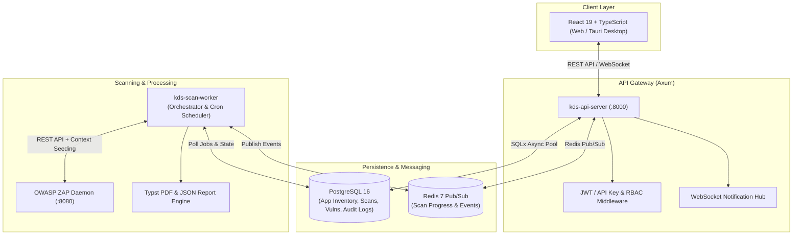
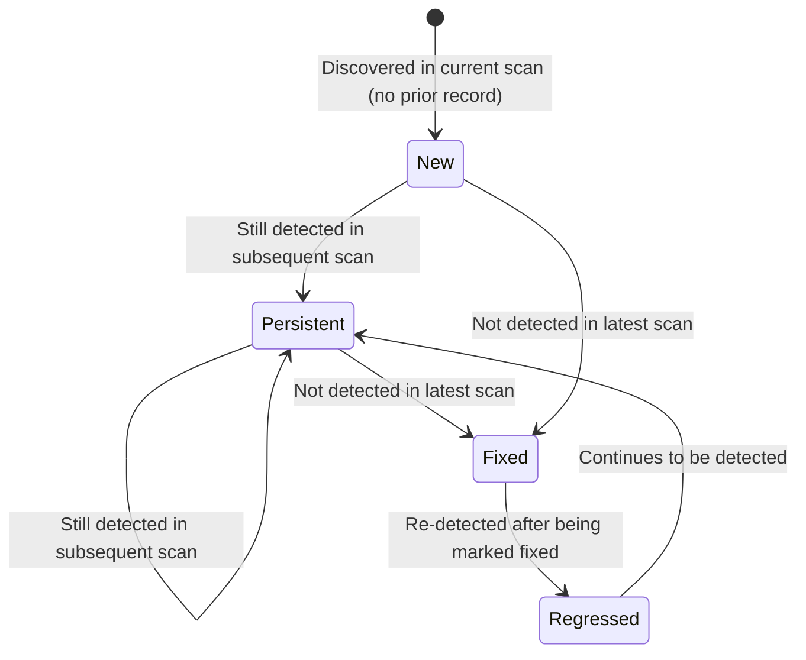

# KDS — Web Application Vulnerability Management Platform

[](https://www.rust-lang.org/)
[](https://github.com/tokio-rs/axum)
[](https://react.dev/)
[](https://www.typescriptlang.org/)
[](https://tauri.app/)
[](https://www.zaproxy.org/)
[](https://www.postgresql.org/)
[](https://redis.io/)
[](https://www.docker.com/)
[](#testing--verification)

**KDS** is an enterprise-grade, monorepo Web Application Vulnerability Management and Automated Security Assessment platform. It combines a high-performance **Rust** backend workspace with a modern **React + TypeScript + Tauri** desktop and web frontend, orchestrating autonomous vulnerability scanning via **OWASP ZAP**, deterministic SHA-256 deduplication, FIRST CVSS v3.1 scoring, automated 4-state diff tracking, and high-fidelity PDF report generation.

---

## Table of Contents

- [Key Capabilities](#key-capabilities)
- [System Architecture](#system-architecture)
- [Monorepo Directory Structure](#monorepo-directory-structure)
- [Default Credentials & RBAC](#default-credentials--rbac)
- [Getting Started](#getting-started)
  - [Prerequisites](#prerequisites)
  - [Option 1: Full-Stack Docker Compose (Recommended)](#option-1-full-stack-docker-compose-recommended)
  - [Option 2: Zero-Dependency Standalone Mode](#option-2-zero-dependency-standalone-mode)
  - [Option 3: Local Bare-Metal Development](#option-3-local-bare-metal-development)
- [Core Engines & Domain Logic](#core-engines--domain-logic)
  - [Deterministic Deduplication](#deterministic-deduplication)
  - [FIRST CVSS v3.1 Scoring](#first-cvss-v31-scoring)
  - [4-State Vulnerability Lifecycle & Scan Diffing](#4-state-vulnerability-lifecycle--scan-diffing)
  - [OWASP Top 10 (2021) Classifier](#owasp-top-10-2021-classifier)
- [REST & WebSocket API Reference](#rest--websocket-api-reference)
- [Testing & Verification](#testing--verification)
- [License](#license)

---

## Key Capabilities

* **Target Inventory & Scope Management**: Catalog web applications with environment tagging (`Production`, `Staging`, `Development`), criticality ratings (`Critical`, `High`, `Medium`, `Low`), explicit authorization attestation, regex scope boundaries, and authenticated session profiles.
* **Autonomous Multi-Profile Scanning**:
  * **Baseline Passive**: Non-intrusive traffic analysis and spidering with zero intrusive payloads. Safe for production environments.
  * **Full Active Attack**: Deep fuzzing covering SQLi, XSS, SSRF, RCE, Path Traversal, and Command Injection via ZAP.
  * **OpenAPI / REST Schema**: Parses OpenAPI/Swagger schemas and executes boundary fuzzing on all endpoints.
  * **SPA Ajax Spider**: Headless Chromium crawler executing DOM interactions for modern React/Vue/Angular applications.
* **Deterministic Deduplication**: Normalizes URL paths according to RFC 3986 (resolving dot segments, percent-decoding, stripping default ports) and computes SHA-256 fingerprints to eliminate duplicate findings across scan runs.
* **FIRST CVSS v3.1 Scoring Engine**: Complete implementation of the FIRST CVSS v3.1 specification calculating Base Score, Impact, Exploitability, and qualitative severity ratings.
* **4-State Vulnerability Lifecycle & Scan Diffing**: Automatically compares successive scans against target baselines, classifying findings into `New`, `Persistent`, `Fixed`, and `Regressed`.
* **Real-Time WebSocket Streaming**: Pub/Sub event bus delivering sub-second scan status updates (`Queued`, `Spidering`, `ActiveScanning`, `Ingesting`, `Completed`) and progress percentages to frontend clients.
* **Executive & Technical PDF Reports**: Embedded Typst engine generating multi-page PDF reports containing executive risk summaries, severity breakdowns, vulnerability tables, and remediation guidance.
* **Role-Based Access Control (RBAC)**: Fine-grained permissions enforced across four user roles: `Admin`, `SecurityEngineer`, `Developer`, and `Auditor`, supported by Argon2 password hashing and JWT + API Key authentication.

---

## System Architecture



---

## Monorepo Directory Structure

```
KDS/
├── backend/                       # Rust Cargo Workspace
│   ├── Cargo.toml                 # Workspace manifest & dependencies
│   ├── Dockerfile                 # Multi-stage release Dockerfile (api & worker)
│   ├── Dockerfile.api             # Dedicated API Server container
│   ├── Dockerfile.worker          # Dedicated Scan Worker container
│   ├── crates/
│   │   ├── shared-types/          # Common DTOs, REST schemas, enums, CVSS models
│   │   ├── core-domain/           # RFC 3986 normalizer, SHA-256 fingerprinting, CVSS v3.1, diffing
│   │   ├── infra/                 # PostgreSQL SQLx repos, Redis pub/sub, Typst PDF, ZAP client
│   │   ├── api-server/            # Axum HTTP/WS gateway, JWT/API-key auth, RBAC middleware
│   │   └── scan-worker/           # Background daemon, ZAP orchestrator, cron scheduler
│   └── tests/
│       └── e2e/                   # 4-tier integration test harness (100% offline)
├── frontend/                      # React + TypeScript + Vite + Tauri v2
│   ├── src/
│   │   ├── components/            # Modals, triage tables, dashboard charts, audit logs
│   │   ├── pages/                 # Inventory, Scans, Vulnerabilities, Reports, Settings
│   │   ├── services/              # API client, WebSocket subscriber, auto-authentication
│   │   └── types/                 # TypeScript interfaces mirrored from shared-types
│   ├── src-tauri/                 # Tauri desktop container configuration
│   └── package.json
├── docker-compose.yml             # Full-stack production compose (API, Worker, DB, Redis, ZAP)
├── docker-compose.standalone.yml  # Zero-dependency in-memory standalone configuration
└── README.md
```

---

## Default Credentials & RBAC

When launching the platform with seeded credentials, the following accounts are pre-configured:

| Role | Email | Password | Permissions |
| :--- | :--- | :--- | :--- |
| **Admin** | `admin@kds.local` | `AdminSecret123!` | Full system access, API keys, user management, scope modification, scan execution, vulnerability resolution. |
| **Security Engineer** | `seceng@kds.local` | `SecEngSecret123!` | Application inventory CRUD, launch/cancel scans, triage vulnerabilities, export PDF/JSON reports. |
| **Developer** | `dev@kds.local` | `DevSecret123!` | Read assigned applications, view scan progress and findings, update remediation statuses (`in_progress`, `resolved`). |
| **Auditor** | `auditor@kds.local` | `AuditorSecret123!` | Read-only access across all applications, scan diffs, vulnerability audit trails, and compliance reports. |

---

## Getting Started

### Prerequisites

* [Docker](https://docs.docker.com/get-docker/) (24.0+) & [Docker Compose](https://docs.docker.com/compose/) (v2+)
* *(Optional for local bare-metal)*: [Rust](https://rustup.rs/) (1.85+ stable) and [Node.js](https://nodejs.org/) (v20+)

---

### Option 1: Full-Stack Docker Compose (Recommended)

Starts all services (`api-server`, `scan-worker`, `postgres`, `redis`, and `zap`):

1. **Clone the repository**:
   ```bash
   git clone https://github.com/LazyKaddu/KDS.git
   cd KDS
   ```

2. **Launch all services**:
   ```bash
   docker compose up -d --build
   ```

3. **Verify running containers**:
   ```bash
   docker compose ps
   ```
   * `kds-api-server`: `http://localhost:8000`
   * `kds-zap`: `http://localhost:8080`
   * `kds-postgres`: `localhost:5432`
   * `kds-redis`: `localhost:6379`

4. **Launch the Frontend**:
   ```bash
   cd frontend
   npm install
   npm run dev
   ```
   Open `http://localhost:5173` in your browser. The frontend will automatically authenticate with the backend.

---

### Option 2: Zero-Dependency Standalone Mode

Run the backend in complete isolation without PostgreSQL, Redis, or ZAP dependencies using embedded in-memory mock adapters:

```bash
docker compose -f docker-compose.standalone.yml up -d --build
```
The standalone server will be available at `http://localhost:8000` pre-seeded with sample inventory and vulnerability data.

---

### Option 3: Local Bare-Metal Development

#### 1. Backend Workspace
```bash
cd backend

# Run the complete test suite (572 tests offline)
cargo test --workspace

# Run the API Gateway in standalone in-memory mode
cargo run -p api-server

# Run the Scan Worker daemon
cargo run -p scan-worker
```

#### 2. Frontend Development
```bash
cd frontend

# Install dependencies
npm install

# Run the web development server
npm run dev

# Run as a native Tauri desktop app
npm run tauri dev
```

---

## Core Engines & Domain Logic

### Deterministic Deduplication
Vulnerability scanners often identify identical flaws across different URL variations (query parameter order, trailing slashes, redundant slashes). `core-domain` implements:
1. **RFC 3986 URL Normalization**:
   - Converts schemes and hosts to lowercase.
   - Resolves relative path traversal segments (`/a/b/../c` $\rightarrow$ `/a/c`).
   - Normalizes empty paths to `/`.
   - Strips default HTTP/HTTPS ports (80/443).
   - Re-encodes query strings deterministically.
2. **SHA-256 Fingerprinting**:
   $$\text{Fingerprint} = \text{SHA-256}(\text{app\_id} \parallel \text{plugin\_id} \parallel \text{normalized\_path} \parallel \text{parameter} \parallel \text{http\_method})$$

### FIRST CVSS v3.1 Scoring
Calculates precise vulnerability severity according to FIRST formulas:
* **Exploitability Sub-Score**:
  $$\text{ISS} = 1 - \big[(1 - \text{Impact}_{\text{Conf}}) \times (1 - \text{Impact}_{\text{Integ}}) \times (1 - \text{Impact}_{\text{Avail}})\big]$$
* **Impact Sub-Score**:
  - Scope Unchanged: $\text{Impact} = 6.42 \times \text{ISS}$
  - Scope Changed: $\text{Impact} = 7.52 \times (\text{ISS} - 0.029) - 3.25 \times (\text{ISS} - 0.02)^{15}$
* **Base Score**: Computed with precision rounding up to the nearest 0.1 (`roundup` specification).

### 4-State Vulnerability Lifecycle & Scan Diffing
When a scan finishes, findings are compared against the target application's previous completed assessment:



* **`New`**: A vulnerability detected for the first time on the application.
* **`Persistent`**: An existing active vulnerability that continues to be present in subsequent scans.
* **`Fixed`**: A previously open vulnerability that was not detected in the latest completed scan.
* **`Regressed`**: A vulnerability previously confirmed resolved that has reappeared in a recent scan.

### OWASP Top 10 (2021) Classifier
Maps CWE IDs and ZAP plugin IDs into official OWASP Top 10 categories:
* **A01:2021** — Broken Access Control (CWE-22, CWE-284, CWE-285, CWE-639)
* **A02:2021** — Cryptographic Failures (CWE-259, CWE-327, CWE-330)
* **A03:2021** — Injection (CWE-79, CWE-89, CWE-77, CWE-78)
* **A04:2021** — Insecure Design (CWE-209, CWE-256)
* **A05:2021** — Security Misconfiguration (CWE-16, CWE-611, CWE-1004)
* **A06:2021** — Vulnerable and Outdated Components (CWE-1104)
* **A07:2021** — Identification and Authentication Failures (CWE-287, CWE-384, CWE-798)
* **A08:2021** — Software and Data Integrity Failures (CWE-494, CWE-502)
* **A09:2021** — Security Logging and Monitoring Failures (CWE-778, CWE-117)
* **A10:2021** — Server-Side Request Forgery (SSRF) (CWE-918)

---

## REST & WebSocket API Reference

The API Server serves routes under `/api/v1` and WebSocket endpoints under `/ws`:

### Authentication & Keys
| Method | Route | Description | Required Role |
| :--- | :--- | :--- | :--- |
| `POST` | `/api/v1/auth/login` | Authenticate with email/password; returns JWT access & refresh tokens | Public |
| `POST` | `/api/v1/auth/refresh` | Refresh an expired access token using a valid refresh token | Public |
| `POST` | `/api/v1/auth/logout` | Revoke current refresh token session | Authenticated |
| `GET` | `/api/v1/auth/me` | Fetch active user profile, assigned role, and permissions | Authenticated |
| `GET` | `/api/v1/auth/keys` | List API keys belonging to the authenticated user | Developer+ |
| `POST` | `/api/v1/auth/keys` | Generate a new hashed API key | Developer+ |
| `DELETE` | `/api/v1/auth/keys/:id` | Revoke an existing API key | Developer+ |

### Application Inventory
| Method | Route | Description | Required Role |
| :--- | :--- | :--- | :--- |
| `GET` | `/api/v1/apps` | List all applications with risk scores and latest scan timestamps | Auditor+ |
| `POST` | `/api/v1/apps` | Register a new target application into the inventory | SecurityEngineer+ |
| `GET` | `/api/v1/apps/:id` | Get details and scope configuration for an application | Auditor+ |
| `PUT` | `/api/v1/apps/:id` | Update application attributes, scope regexes, or criticality | SecurityEngineer+ |
| `DELETE`| `/api/v1/apps/:id` | Delete an application and cascade delete historical scans | Admin |
| `GET` | `/api/v1/apps/:id/trends`| Retrieve 30-day historical risk and vulnerability trends | Auditor+ |

### Scan Assessments
| Method | Route | Description | Required Role |
| :--- | :--- | :--- | :--- |
| `POST` | `/api/v1/apps/:id/scans`| Trigger an assessment (`baseline_passive`, `full_active`, etc.) | SecurityEngineer+ |
| `GET` | `/api/v1/scans` | List all scans across the platform with filtering and pagination | Auditor+ |
| `GET` | `/api/v1/scans/:id` | Get status, phase, execution duration, and progress percent | Auditor+ |
| `POST` | `/api/v1/scans/:id/cancel`| Gracefully cancel an active scan execution | SecurityEngineer+ |
| `GET` | `/api/v1/scans/diff` | Compare findings between two scans (diff breakdown) | Auditor+ |
| `GET` | `/api/v1/scans/:id/findings` | Fetch all vulnerabilities discovered during a scan | Auditor+ |

### Vulnerability Triage
| Method | Route | Description | Required Role |
| :--- | :--- | :--- | :--- |
| `GET` | `/api/v1/vulnerabilities` | List and filter vulnerabilities across status, severity, and CWE | Auditor+ |
| `GET` | `/api/v1/vulnerabilities/:id` | Get full details, CVSS vector, HTTP request/response evidence | Auditor+ |
| `PATCH` | `/api/v1/vulnerabilities/:id` | Update remediation status (`false_positive`, `resolved`, etc.) | Developer+ |
| `POST` | `/api/v1/vulnerabilities/:id/comments` | Append an audit comment to the vulnerability timeline | Developer+ |
| `POST` | `/api/v1/vulnerabilities/bulk-update` | Bulk modify status or assignees across multiple findings | SecurityEngineer+ |

### Reporting & Real-Time Feeds
| Method | Route | Description |
| :--- | :--- | :--- |
| `GET` | `/api/v1/dashboard/summary` | Global posture summary (active apps, total vulns, severity matrix) |
| `GET` | `/api/v1/reports/:id/pdf` | Generate and download executive/technical Typst PDF report |
| `GET` | `/api/v1/reports/:id/json` | Export raw scan results and vulnerability findings in JSON format |
| `WS` | `/ws/scans/:id/progress` | Live scan progress feed streaming status, phase, and alert counts |
| `WS` | `/ws/v1/notifications` | Global system alert channel for scan completions and failures |

---

## Testing & Verification

The backend is built with a zero-external-dependency testing philosophy. Every unit, integration, and end-to-end test executes in memory without requiring a live PostgreSQL instance or running ZAP daemon:

```bash
cd backend

# Execute all 572 tests across all workspace crates
cargo test --workspace
```

### Test Suite Distribution

* **`core-domain` (36 tests)**: FIRST CVSS v3.1 benchmark vectors, round-up boundary tests, RFC 3986 path normalization, SHA-256 collision resistance, and 4-state diffing transitions.
* **`shared-types` (51 tests)**: Serialization/deserialization validation, CVSS string round-trips, and WebSocket event payloads.
* **`infra` (432 tests)**: In-memory repositories, SQLx database migration checks, ZAP parser edge cases, and Typst report compilation.
* **`api-server` (15 tests)**: Route authentication, RBAC policy enforcement, preflight CORS checks, and WebSocket upgrade handshakes.
* **`scan-worker` (28 tests)**: Scan lifecycle orchestrator, polling error handling, cron evaluator, and background task cancellation.
* **`tests/e2e` (10 tests)**: End-to-end user workflows spanning registration, scan execution, vulnerability diffing, and PDF generation.

---

## License

This project is licensed under the **MIT OR Apache-2.0** License.
